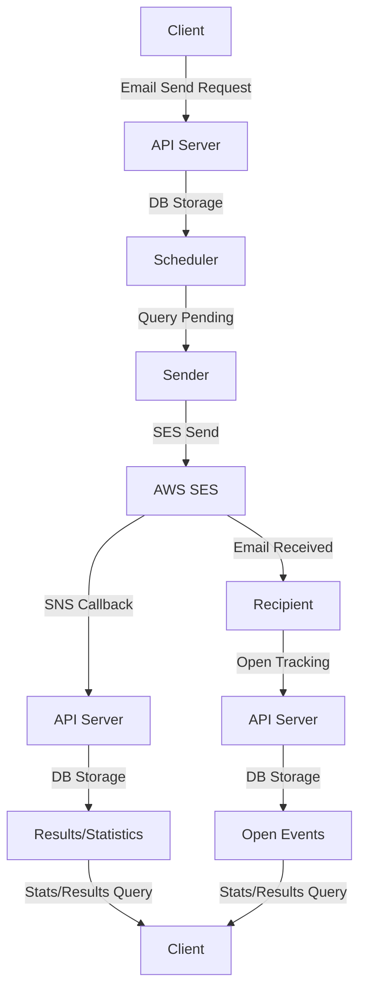

# AWS SES Email Sender

[](https://github.com/gofiber/recipes/tree/master/aws-ses-sender) [](https://stackblitz.com/github/gofiber/recipes/tree/master/aws-ses-sender)

This is an AWS SES-based Golang email delivery service that extracts only the basic sending functionality from [my open-source project](https://github.com/lee-lou2/aws-ses-sender-go).

## Features
- [x] Email sending using AWS SES
- [x] Designed with daily limits and per-second sending rates in mind
- [x] Scheduled sending and message grouping
- [x] Email open tracking and result collection
- [x] View daily sending counts and delivery results by message group

## Flowchart



## Requirements

### Essential Requirements
- Go 1.27 or higher
- AWS account and configuration
  - AWS SES service activated
  - Sender email or domain verification completed
  - IAM user with SES permissions
  - AWS Access Key and Secret Key
- PostgreSQL 14.0 or higher
- (Optional) Docker

### AWS SES Configuration
1. Verify sender email/domain in AWS SES console
2. Request removal from SES sandbox mode (for production)
3. Create SNS topic and set up SES feedback notifications. Set `SNS_TOPIC_ARN` (see Configuration) and then subscribe `https://<your server>/v1/events/results` (HTTPS) to the topic. The first message is a subscription confirmation, which is verified like every other message: the server logs a URL, and opening it confirms the subscription
4. Grant following permissions to IAM user
  - `ses:SendEmail`
  - `ses:SendRawEmail`
  - `sns:Publish` (if using SNS for delivery notifications)
  - `sns:Subscribe` (if using SNS for delivery notifications)

## Project Structure
```plaintext
aws-ses-sender/
├── main.go              # Application entry point
├── api/                 # HTTP API related code
│   ├── handler.go       # API handler functions
│   ├── route.go         # API routing configuration
│   ├── server.go        # HTTP server setup/execution
│   └── middlewares.go   # API authentication middleware
├── cmd/                 # Background job code
│   ├── scheduler.go     # Pending email scheduler
│   └── sender.go        # SES email sending processor
├── config/              # Application settings
│   ├── env.go           # Environment variable management
│   └── db.go            # Database connection settings
├── model/               # Database models
│   └── email.go         # GORM model definitions
└── pkg/
    ├── aws/             # AWS service integration
    │   └── ses.go       # SES email sending
    ├── sns/             # Verifies the signature of the messages SNS posts
    └── tracking/        # Signs the links of the open tracking image
```

## Setup

### Prerequisites

- Go language development environment
- AWS account and SES service configuration
  - Sender email/domain verification
  - IAM user creation with SES permissions
- PostgreSQL database
- (Optional) Sentry DSN

### Configuration

Create a `.env` file in the project root and set the following environment variables:

```env
# AWS Related
AWS_ACCESS_KEY_ID=your_access_key
AWS_SECRET_ACCESS_KEY=your_secret_key
AWS_REGION=ap-northeast-2
EMAIL_SENDER=sender@example.com

# Server and API
SERVER_PORT=3000
API_KEY=your_api_key
# The URL recipients' mail clients use to reach this server, for the open tracking image
SERVER_HOST=http://localhost:3000

# The SNS topic that delivers the SES feedback. Messages from any other topic are rejected,
# and so is every message while this is empty. Several ARNs are separated by commas.
SNS_TOPIC_ARN=arn:aws:sns:ap-northeast-2:123456789012:your-ses-topic

# Signs the links of the open tracking image. Use a long random string of its own, for example
# the output of `openssl rand -hex 32`, and not the API key. Without it the emails get no
# tracking image and no opens are recorded.
TRACKING_SECRET=a_long_random_string

# Database (PostgreSQL)
DB_HOST=localhost
DB_PORT=5432
DB_USER=postgres
DB_PASSWORD=postgres
DB_NAME=postgres

# Sending rate per second
EMAIL_RATE=14

# Sentry (Optional)
SENTRY_DSN=your_sentry_dsn
```

### Installation and Execution

1. Clone repository:
   ```bash
   git clone <repository_URL>
   cd aws-ses-sender
   ```

2. Install dependencies:
   ```bash
   go mod tidy
   ```

3. Run application:
   ```bash
   go run main.go
   ```

   Or run it with Docker. The image does not contain your `.env`, so pass the variables at run time:
   ```bash
   docker build -t aws-ses-sender .
   docker run --rm --env-file .env -p 3000:3000 aws-ses-sender
   ```

## API Endpoints

`POST /v1/messages`, `GET /v1/topics/:topicId`, `GET /v1/events/counts/sent` and the `/debug/pprof` profiling endpoints require the header `x-api-key: <API_KEY>`.

### Email Sending Request
```http
POST /v1/messages
```

Request body example:
```json
{
  "messages": [
    {
      "topicId": "promotion-event-2024",
      "emails": ["recipient1@example.com", "recipient2@example.com"],
      "subject": "Special Promotion Notice",
      "content": "<h1>Hello!</h1><p>Check out our special promotion details.</p>",
      "scheduledAt": "2030-12-25T10:00:00+09:00"
    }
  ]
}
```

`scheduledAt` is optional and has to be a time in the future in RFC 3339 format. Without it the message is sent as soon as possible, and a time in the past is answered with `400 Bad Request`.

### View Topic Sending Statistics
```http
GET /v1/topics/:topicId
```

### Email Open Tracking
```http
GET /v1/events/open?requestId={requestId}&token={token}
```

The sender appends an image with this link to every email. It does not need the API key, because the recipient's mail client opens it, but the `token` is an HMAC of the `requestId`, made with `TRACKING_SECRET`. The request ids are a counter that anyone can count along, so without the token anybody could report any email as opened. A request without a valid token still gets the image and is not recorded.

Every email carries a link, so everyone who receives one can try guesses for the secret offline until the token matches. That is why `TRACKING_SECRET` has to be a random string of its own and not a password or the API key. Changing it stops the links in emails that were sent before from being counted.

The link belongs to one email, but whoever holds it can open it as often as they like, and every valid request adds an `Open` row. Mail clients also fetch images on their own, and some of them prefetch every image through a proxy. Treat the count as a rough measure. This endpoint is public, so for production put a rate limit in front of it, for example in the reverse proxy or with Fiber's limiter middleware.

### View Sending Statistics
```http
GET /v1/events/counts/sent?hours={hours}
```

### Receive Sending Results (AWS SNS)
```http
POST /v1/events/results
```

SNS posts the SES feedback to this endpoint, which is why it does not use the API key. Instead the server checks every message: it has to come from a topic in `SNS_TOPIC_ARN` and carry a valid signature by a certificate that AWS publishes (`SigningCertURL` has to be an `sns.<region>.amazonaws.com` URL). The topic matters as much as the signature, because anyone with an AWS account can have SNS sign messages for a topic of their own. Anything else is answered with `403 Forbidden` and nothing is stored.